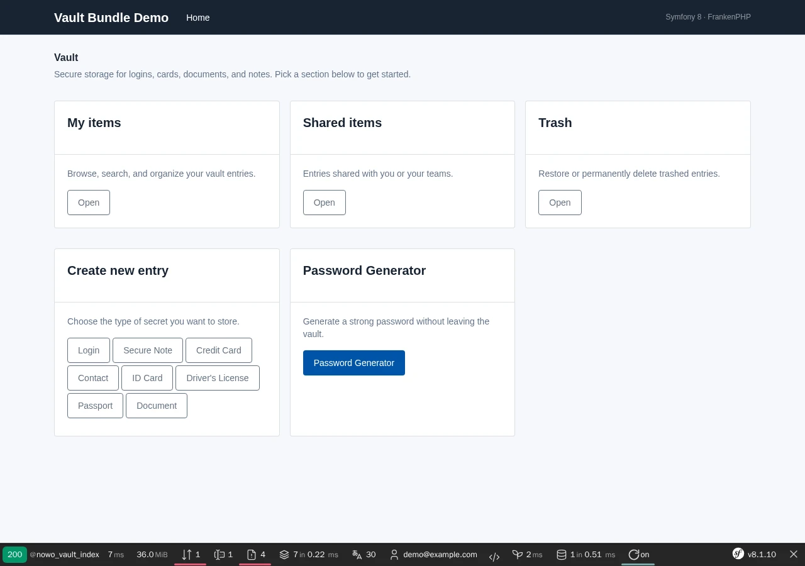
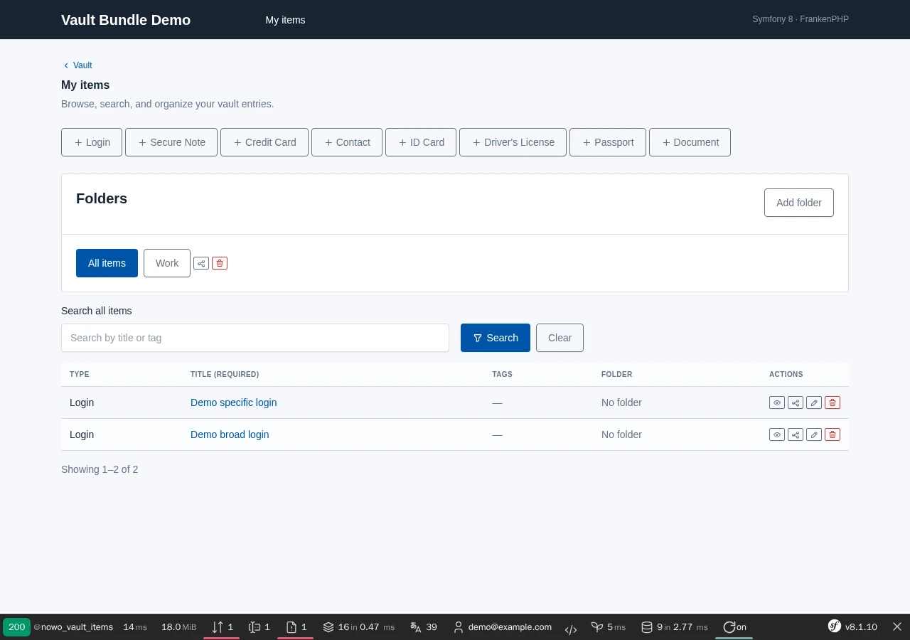
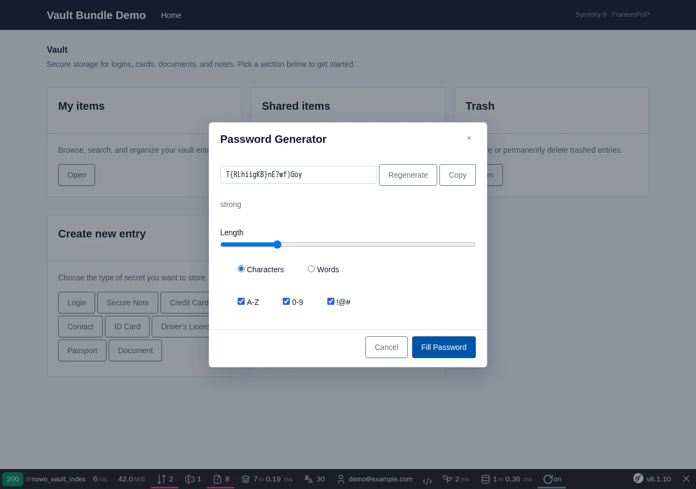

# Vault Bundle

[](https://github.com/nowo-tech/VaultBundle/actions/workflows/ci.yml) [](https://packagist.org/packages/nowo-tech/vault-bundle) [](https://packagist.org/packages/nowo-tech/vault-bundle) [](LICENSE) [](https://php.net) [](https://symfony.com) [](https://github.com/nowo-tech/VaultBundle) [](#tests-and-coverage)

> ⭐ **Found this useful?** Give it a **star** on [GitHub](https://github.com/nowo-tech/VaultBundle) so more developers can find it.

Symfony bundle for a **password and secrets vault**: logins, secure notes, credit cards, contacts, identity documents, folders, sharing, trash, read-only events, and a built-in password generator.


This bundle is **FrankenPHP worker mode friendly**.

| Vault home | Items list | Password generator |
| --- | --- | --- |
|  |  |  |

## Features

- Item types: login, secure note, credit card, contact, ID card, driver's license, passport, document
- Folders with share and trash; item soft-delete with restore/purge
- **Tags** — label items, filter and search by tag
- `VaultGrant` for users and teams (read / write / admin) + share UI
- `VaultTeamMembershipResolverInterface` for team-based grants
- **Browser extension** — REST API + Chrome/Firefox autofill (optional)
- **Runtime config** — optional DB-backed settings with admin UI
- **Key rotation** — `nowo:vault:reencrypt`; **`nowo:vault:extension-tokens:purge`** for expired browser-extension tokens
- Events: list query/result, access check, read-only resolve, extension auth
- Server-side libsodium payload encryption; CSRF on manage POST actions
- Manage UI on the **UiKit page contract** (dashboard, list, form and settings scaffolds; one host theme for every Nowo bundle; confirm and generator `<dialog>`s, no inline JS) — see [docs/TEMPLATES.md](docs/TEMPLATES.md)
- Document attachments (encrypted in payload)

## Installation

```bash
composer require nowo-tech/vault-bundle
```

```bash
php -r 'echo base64_encode(random_bytes(32)), PHP_EOL;'
```

```yaml
# config/packages/nowo_vault.yaml
nowo_vault:
    user_class: App\Entity\User
    encryption_key: '%env(VAULT_ENCRYPTION_KEY)%'
```

See [Installation](docs/INSTALLATION.md).

## Demo

```bash
make -C demo/symfony8 up
# Demo started at: http://localhost:8023  →  /tools/vault (auto-login)
```

The screenshot at the top of this README comes from this demo (fixture data only); refresh it with `make -C demo/symfony8 demo-screenshots` (`make -C demo/symfony8 test-e2e` runs the Playwright happy path).

## Documentation

- [Installation](docs/INSTALLATION.md)
- [Configuration](docs/CONFIGURATION.md)
- [Usage](docs/USAGE.md)
- [Templates (UiKit page contract)](docs/TEMPLATES.md)
- [Contributing](docs/CONTRIBUTING.md)
- [Code of Conduct](CODE_OF_CONDUCT.md)
- [Changelog](docs/CHANGELOG.md)
- [Upgrading](docs/UPGRADING.md)
- [Release process](docs/RELEASE.md)
- [Security](docs/SECURITY.md)
- [Engram](docs/ENGRAM.md)
- [Spec-driven development](docs/SPEC-DRIVEN-DEVELOPMENT.md)
- [GitHub Spec Kit](docs/SPEC-KIT.md)

### Additional documentation

- [GitHub Actions CI requirements](docs/GITHUB_CI.md)
- [PSR evaluation (REQ-CS-007)](docs/PSR.md)
- [Browser extension](docs/BROWSER-EXTENSION.md)
- [Encryption key rotation](docs/ENCRYPTION-KEY-ROTATION.md)
- [Access control & read-only events](docs/examples/AccessControl.md)
- [Demo with FrankenPHP](docs/DEMO-FRANKENPHP.md)

## Tests and coverage

- **PHP: 100%** lines (3376/3376 of `src/`, PHPUnit unit + integration + kernel E2E suites; only `src/Resources` — Twig, translations, config, built assets — is outside the measure). Gate: `make test-coverage-100` / CI fail below 100%.
- **TS/JS: 99.69%** lines (326/327; 95.28% branches) over every TypeScript source of `src/Resources/assets/src` and `extension/src` (Vitest + jsdom). Gate: thresholds in `vitest.config.ts` (lines 98%), enforced by `pnpm run test:coverage` locally and in CI.
- **Python:** N/A (no Python code).

```bash
make test              # PHPUnit
make test-coverage     # PHP coverage report (text + clover + HTML)
make test-coverage-100 # Same, failing below 100% lines
make test-ts           # Vitest with coverage thresholds
make release-check     # Full pre-release QA
```

## License

MIT — see [LICENSE](LICENSE).
